# Are space data centers feasible? A first-principles assessment

*October 2026. Interactive version: [`space-dc-feasibility.html`](space-dc-feasibility.html). Model: [`space_dc_model.py`](space_dc_model.py) (run `python3 space_dc_model.py`; full console output in [`model_output.txt`](model_output.txt), all numbers in [`results.json`](results.json)).*

---

## 0. The answer in one page

**Is it physically possible?** Yes. No law of physics rules it out, and the energy and cooling physics is *less* hostile than the popular "you can't cool things in a vacuum" argument suggests.
- In a dawn–dusk sun-synchronous orbit at 650 km, a solar array sees sunlight **96% of the time**. Per square metre of panel, that is about **6× the yearly energy** of a good ground site.
- A radiator at ~320 K (47 °C) rejects **~740 W/m²** of panel after accounting for Earth's infrared glow. The array delivers ~210 W/m² of electricity, so **the radiator only needs to be ~28% of the array's area**.

**Is it practical at scale?** Only with heavy caveats. Three things bite hard:

1. **Mass.** A 2030-credible design weighs **~30 kg per kW of compute**. Today's flight-proven parts give ~50 kg/kW, and an aggressive purpose-built design ~18 kg/kW. One gigawatt is therefore **~18,000–50,000 t in orbit**: 180–500 launches of a 100-t-class rocket, repeated every ~5 years as the hardware wears out. All rockets combined launched roughly a few thousand tonnes in 2025.
2. **Radiation.** Google's own proton-beam test of its Trillium TPU, scaled to the expected orbital dose (~150 rad/yr behind ~10 mm Al at 650 km), gives each chip ~9 silent data corruptions and ~3 uncorrectable memory errors per year.
   - A 16,000-chip training cluster would see **a silent corruption every ~4 minutes and an uncorrectable memory error every ~9 minutes**.
   - If each memory error crashes the job, as it usually does on the ground today, a synchronous training run spends **~90% of its time restarting**.
   - Inference tolerates this. Large synchronous training does not, unless the software changes.
3. **No repair.** Failed GPUs stay failed. At 3–6%/yr hard-failure rates, the fleet averages only ~86–90% of its launched capacity over a 5-year life.

**Is it profitable?** Not in any scenario I consider realistic for the next decade. Even under the most favourable assumptions, the upside is capped at roughly 15–25%.
- **Where the money goes.** The model says plainly what industry data (Epoch AI) also shows: in a modern AI data center **the chips are ~66% of the levelised cost, and electricity is only ~7%**. Facility ~15%, opex ~12%.
- **The ceiling.** A space data center can only attack the ~34% that is not chips. It cannot make the chips cheaper, and in practice makes them dearer: qualification, no repair, lost eclipse time.
- **Even with free launch and a free satellite, orbit is only 6–20% cheaper than the ground** at today's chip prices. That is the theoretical ceiling.
- **With realistic costs** (cost per *delivered* kW-year of compute, space ÷ ground):

| Scenario | Specific mass | Launch price | Satellite hardware | Space ÷ ground |
|---|---|---|---|---|
| Today (flight-proven parts, 2026 prices) | 50 kg/kW | $3,000/kg | $2,000/kg | **7.9×** |
| Near term (~2030, early Starship, Starlink-style production) | 30 kg/kW | $600/kg | $800/kg | **2.0×** |
| Optimistic (~2035, Google's $200/kg threshold met) | 18 kg/kW | $200/kg | $400/kg | **1.15×** |
| "Advocate" (assumptions behind the boldest public claims) | 9 kg/kW | $50/kg | $150/kg | **0.84×** |

- **Monte Carlo.** A Monte Carlo over a generous 2030s envelope (20,000 samples, 13 uncertain inputs) gives a median of **2.4×**, a 90% interval of **1.4–4.7×**, and **essentially zero probability that orbit is cheaper**.
- **What drives the answer.** The two dominant levers are launch price and the cost per kg of the satellite itself. Next is radiator areal mass.
- **The other way to win.** Ground power would have to become very expensive or unavailable: **~$1.2/kWh** against the near-term design, **~$0.24/kWh** against the optimistic one. On-site gas or solar-plus-storage can supply ground data centers at ~$0.08–0.15/kWh, which puts a ceiling on how much "power scarcity" can help orbit.

**Bottom line.**
- Small orbital compute (kW–100 kW) makes sense today for **processing data that is already in space** (Earth observation, space situational awareness, military/sovereign edge).
- Gigawatt-scale orbital AI factories are a **plausible engineering project but a poor investment** unless all of the following happen together:
  - launch near $100–200/kg *and* satellite hardware below ~$300/kg;
  - specific mass near 10 kg/kW;
  - radiation- and repair-tolerant software and hardware.
- Even then, the prize is a modest discount (~15–25% at today's chip prices; ~40% only if chips also get ~3× cheaper per watt), not the "10× cheaper" sometimes claimed.

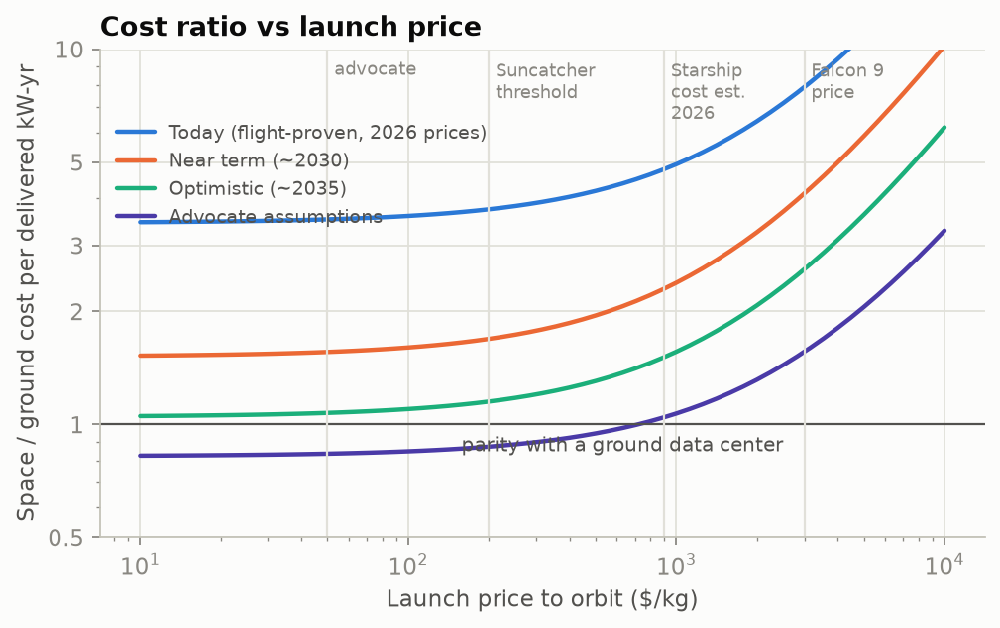

---

## 1. What is actually being proposed (and what has actually flown)

The 2025–26 wave of announcements is large; demonstrated hardware is tiny. The table separates the two. Sources are listed in §13. Many were gathered from secondary reporting because primary PDFs were inaccessible from my environment; items flagged † should be checked against the primary source.

| Actor | Claim / plan | What has actually happened (Oct 2026) | Status |
|---|---|---|---|
| **Starcloud** (ex-Lumen Orbit) | 2024 whitepaper: 5 GW cluster, ~4 km × 4 km arrays, "10× cheaper energy". 40 MW for 10 yr would cost $8.2M in space vs $167M on the ground. FCC filing for 88,000 sats. Starcloud-3 (~3 t, 200 kW) "cost-competitive at $500/kg". | Starcloud-1 (60 kg, one H100) launched Nov 2025; trained nanoGPT and ran Gemma in orbit. No error or thermal statistics published. Starcloud-2 slipped to late 2026. ~$450M raised. | Demo + aspiration |
| **Google Project Suncatcher** | 81-satellite, 1-km-radius TPU clusters at 650 km dawn–dusk SSO. ~10 Tbps optical links. Parity "if launch ≤ $200/kg by mid-2030s". | Proton-beam tests of Trillium TPU (see §6). 1.6 Tbps bench optical link. **First 4-TPU, ~1 kW prototype launched 1 Oct 2026** (with Planet). No compute results yet. | Measured on ground; first flight just launched |
| **SpaceX / xAI** | FCC filing (Jan 2026) for up to 1 million satellites. "100 GW of AI compute per year", ~1 Mt/yr. "AI1" satellite: 120 kW average, ~110 m² liquid radiator, 1 GW/yr by end-2027. | Starship reached orbit for the first time on 28 Sep 2026 (26 Starlink V3s). The May 2026 S-1 risk factors say orbital data centers "may not achieve commercial viability". | Aspiration (design only) |
| **Blue Origin, Aetherflux, Axiom, Sophia Space, NVIDIA** | 51,000-sat "Project Sunrise" filing; "Galactic Brain" by 2027; ISS / Kepler-hosted edge nodes; 1 m² "TILE" modules; NVIDIA "Space-1 Vera Rubin" module. | Axiom/Kepler edge nodes in orbit (small). Others not yet flown. | Mostly aspiration |
| **China, "Three-Body Computing Constellation"** | 2,800 sats, 1,000 POPS. | 12 satellites launched May 2025; ~744 TOPS each (almost certainly INT8 edge-inference peak). | Small demo |
| **ESA ASCEND** (Thales Alenia) | 1 GW by 2050. CO₂ benefit only if launchers become ~10× less emissive over their life cycle. | Study only. | Study |

**What has not been demonstrated anywhere:**
- an orbital compute satellite above ~1 kW;
- a radiator above ~10 kW serving compute;
- 100–200 m formation flying of dozens of satellites;
- commercial launch below ~$1,000/kg;
- any on-orbit replacement of a GPU.

---

## 2. The model in one page

Everything is normalised to **1 kW of IT power**: electricity delivered to accelerators, their host CPUs, memory and network. Bigger data centers are N copies of this kilowatt, plus scale effects treated separately (launch cadence, debris, comms).

**Orbit and environment.** A circular dawn–dusk sun-synchronous orbit (local time of ascending node 18:00).
- The solar beta angle is computed for every day of the year from the J2-driven nodal precession. That gives the eclipse fraction.
- Earth's infrared and reflected-sunlight load on a sun-edge-on radiator is computed by numerically integrating view factors over a Lambertian Earth (300,000-point quadrature, orbit-averaged).

**Power.** Array electrical output per m² at end of life:

$$p_\text{array} = S_0\,\eta_\text{cell}\,\phi_\text{pack}\,\cos\theta\,(1-\delta_T)\,(1-d)^{L}$$

- $S_0 = 1361$ W/m² (solar constant), $\eta_\text{cell}$ cell efficiency, $\phi_\text{pack}$ packing fraction, $\cos\theta$ pointing loss.
- $\delta_T$ is the loss from operating hot, $d$ the annual degradation rate, $L$ the lifetime in years.

The array is sized for IT + bus overhead, divided by power-conversion efficiency. In eclipse the IT throttles, and a small battery carries only the bus.

**Cooling.** All electrical power ends up as heat. Net rejection per m² of a two-sided panel:

$$q(T) = \eta_\text{fin}\sum_{\text{faces}}\left[\varepsilon\sigma T^4 - \varepsilon\,\text{OLR}\,F_i - \alpha_s\,a\,S_0\,F_{a,i}\right]$$

- $F_i$ and $F_{a,i}$ are the orbit-averaged Earth IR and albedo view factors for each face.
- OLR = 239 W/m² is Earth's outgoing longwave radiation; $a = 0.30$ is Earth's albedo.

**Mass.**

$$m = (1+s)\left[\frac{P_\text{array}}{\alpha_\text{sa}} + \frac{Q}{q(T)}\rho_\text{rad} + m_\text{batt} + m_\text{IT} + m_\text{shield}\right]$$

- $\alpha_\text{sa}$ is array specific power (W/kg); $\rho_\text{rad}$ is radiator areal mass (kg/m²), including the pumped loop.
- $s$ is the structure and harness fraction.

**Reliability.**
- Hard failures are exponential and never repaired. The mean surviving capacity is $\overline{C}=(1-e^{-\lambda L})/(\lambda L)$.
- Job interrupts are treated with Young–Daly optimal checkpointing: interval $\tau=\sqrt{2\delta M}$, where $M$ is the system mean time between failures and $\delta$ the checkpoint write time.
- Radiation event rates come from Google's beam test (§6).

**Economics.** Levelised cost of one **delivered** IT-kW-year, using capital-recovery factors $k(r,n)=r/(1-(1+r)^{-n})$.

$$\text{Ground} = \frac{C_\text{IT}\,k(r,5) + C_\text{fac}\,k(r,15) + \text{PUE}\cdot p_e\cdot 8766\cdot A_g + o_g(C_\text{IT}+C_\text{fac})}{A_g}$$

$$\text{Space} = \frac{\big[C_\text{IT}(1+\pi) + m_\text{non-IT}\,c_\text{sc} + m\,c_L + C_\text{comms}\big](1+r)^{t_b}\,k(r,L) + \text{opex}}{A_s}$$

- $\pi$ is the space-qualification premium on IT hardware; $c_\text{sc}$ is spacecraft hardware cost per kg; $c_L$ is launch price per kg; $t_b$ is the build-and-launch delay (interest during construction).
- $A_s$ = (sunlit fraction) × (mean surviving fraction) × 0.99.
- The ground facility is amortised over 15 years and refilled with new chips. The **whole spacecraft** (power, thermal, structure) dies with its chips and must be amortised over ~5 years.

Scenario inputs (all others at defaults in the code):

| Input | Today | Near term (~2030) | Optimistic (~2035) | Advocate |
|---|---|---|---|---|
| Cells | Si 22% | Si 22% | Si 22% | Si 24% |
| Array specific power (W/kg) | 100 (ROSA-class) | 150 | 250 | 500 |
| Radiator areal mass (kg/m²) | 10 | 6 | 4 | 2 |
| Radiator temperature | 315 K | 320 K | 330 K | 340 K |
| IT hardware mass (kg/kW) | 10 | 6 | 4.5 | 3 |
| Shielding (kg/kW) | 2.0 | 1.5 | 1.0 | 0.5 |
| Launch ($/kg) | 3,000 | 600 | 200 | 50 |
| Spacecraft hardware ($/kg, non-IT) | 2,000 | 800 | 400 | 150 |
| IT space premium | 15% | 10% | 5% | 0% |
| Hard-failure rate (space ÷ ground 3%/yr) | 2× | 1.5× | 1.25× | 1× |

Shared ground and economic inputs:
- **IT hardware:** $30k per kW (GB200 NVL72 is $3.1–3.9M for 120–132 kW).
- **Facility:** $15k per kW (JLL shell average $11.3M/MW; AI liquid-cooled $20M+/MW).
- **Electricity and PUE:** $0.08/kWh at PUE 1.2 (US industrial average 8.6–9.3 ¢/kWh).
- **Finance:** 8% discount rate, 5-year chip life.

---

## 3. Power: the one thing space genuinely does better

**Sunlight.** In a dawn–dusk SSO the orbit plane rides the day–night terminator, so the satellite is almost always in sunlight. Computing the beta angle for each day of the year:

| Altitude | Mean time in eclipse | Longest eclipse | Eclipse season |
|---|---|---|---|
| 500 km | 5.4% | 22.6 min | 103 d/yr |
| **650 km** | **3.9%** | **19.7 min** | **87 d/yr** |
| 800 km | 2.7% | 16.8 min | 73 d/yr |
| 1000 km | 1.5% | 13.0 min | 55 d/yr |
| 1200 km | 0.6% | 8.5 min | 35 d/yr |

So "continuous sunlight" is ~96% true at 650 km. The cheapest answer to the remaining eclipses is to **throttle compute** and carry only the bus on a ~0.5 kg/kW battery. Carrying the full IT load through a 20-minute eclipse would add a battery that costs more than the 4% of compute it saves.

**Energy per panel.** $1361\times0.96$ W/m² continuous in orbit, versus ~1000 W/m² peak × ~22% capacity factor on the ground. That is **~6× more energy per m² of panel**, consistent with Google's "up to 8×".

**Which cells?** This choice decides the economics.
- **III-V triple-junction cells** (30–33% efficient) cost **$100–450 per watt**. A 1 kW IT node needs ~1.3 kW of array at beginning of life, which would add $130k–600k per kW. That is 4–20× the price of the GPUs.
- So at scale you **must** use silicon, as Starlink does (~$0.5/W cells; ~22% efficient, degrading ~2.5%/yr).
- With silicon, the array delivers **235 W/m² at beginning of life and 207 W/m² after 5 years**, running at ~47 °C.

**What does the electricity cost?** Counting only the array (plus its share of structure), at each scenario's manufacturing and launch prices:

| | Array $/W (BOL) | Array-only electricity cost |
|---|---|---|
| Today | $57 | $1.80/kWh |
| Near term | $11 | $0.34/kWh |
| Optimistic | $2.7 | $0.084/kWh |
| Advocate | $0.43 | $0.014/kWh |
| *Ground utility PV (~$1/W, 25 yr)* | — | *~$0.05/kWh* |

So the 6× sunlight advantage is eaten by launch and space-hardware cost until launch falls to ~$200/kg *and* arrays are built like Starlink's.

The "energy is 10× cheaper in space" claim is true only for the array in the advocate world. Even there it is the wrong metric: electricity is 7% of the bill (§9).

---

## 4. Cooling: harder than on Earth, but not the show-stopper it is often made out to be

**Physics.** A radiator in vacuum rejects $\varepsilon\sigma T^4$ per face. At 320 K and $\varepsilon = 0.88$ that is ~523 W/m² per face before environmental loads.

**Keeping the radiator out of the sun.** In a dawn–dusk orbit the sun is nearly along the orbit normal. So the arrays face the sun and the radiators can be kept **edge-on to the sun**, perpendicular to the arrays. The remaining loads come from Earth:

| Radiator orientation | Earth IR view factor per face | Albedo factor per face | Net flux at 320 K | Effective sink temperature |
|---|---|---|---|---|
| Radial (one face nadir, one zenith) | 0 / 0.81 | 0 / 0.077 | **740 W/m²** | 205 K |
| Along-track (both faces see the limb) | 0.24 / 0.24 | 0.022 / 0.022 | 800 W/m² | 180 K |

The along-track orientation rejects ~8% more heat, but puts the radiator face-on to the velocity vector.
- Drag then costs ~7 m/s/yr at 650 km, or 37 m/s/yr at solar maximum. That is trivial with electric propulsion.
- At 500 km it becomes 73–366 m/s/yr, which is not trivial.
- The sun-pointing arrays themselves are nearly edge-on to the flow in this orbit.

**Radiator area vs array area.** With silicon arrays at 207 W/m² and radiators at ~740 W/m², the radiator area is **~28% of the array area** (1.6 m² vs 5.7 m² per kW). The radiator is *not* the biggest thing in the sky; the solar array is.

**Radiator mass is another matter.**
- Pumped-fluid radiators with headers, micrometeoroid armour and redundancy weigh **6–15 kg/m²** in recent analyses. The ISS system is ~15 kg/m² at low temperature, ~13 W/kg. Vendor deployables quote 3.5–5 kg/m².
- At 6 kg/m² the radiator is **~9.5 kg/kW, the single heaviest subsystem** in the near-term design, edging out the array.

**Temperature is the master variable.**
- Net flux scales as $T^4$ minus the environmental term. Raising radiator temperature from 300 to 340 K raises flux ~60%.
- But GPUs want a liquid-coolant supply of ~45 °C. Junction throttling begins at ~83–87 °C, and HBM runs 10–20 K hotter than the die.
- Allowing for the cold-plate, coolant and fin temperature drops, a **radiator mean of ~305–335 K** is realistic.
- Chips designed to run hotter (100+ °C junctions) would be one of the highest-leverage innovations available.

**Two public claims checked against the model:**
- **Starcloud's whitepaper** assumes **838 W/m² at 20 °C (293 K)**.
  - That is exactly the *ideal black-body* number: $2\sigma T^4$ with $\varepsilon = 1$, no Earth load, perfect fins.
  - The model gives **475 W/m²** (radial) to **536 W/m²** (along-track) at 293 K.
  - Their radiator is undersized by ~1.6–1.8×.
- **SpaceX AI1**: ~150 kW rejected by ~110 m² of panel is ~1,360 W/m² of planform.
  - Even an ideal panel with no Earth load needs **340 K (67 °C) mean**. With realistic Earth loading and fin efficiency the model needs **~362 K (89 °C)**.
  - That is hotter than any GPU liquid loop runs today. Either the chips run unusually hot, a heat pump is used, or the quoted number is a peak absorbed by thermal storage.

**Would a heat pump help?** Lifting heat from $T_c$ to $T_h$ costs work $W = Q(T_h-T_c)/(\eta_c T_c)$, where $\eta_c$ is the fraction of Carnot efficiency achieved. That work must be generated by extra array and then radiated too. Expanding the total mass to first order in $\Delta T$, a small lift pays only if

$$(4\eta_c - 1)\,\frac{\rho_\text{rad}}{q} \;>\; \frac{1}{\alpha_\text{sa}}\times(\text{EOL/BOL and PMAD factors})$$

In words: the radiator's kg per watt rejected, weighted by $(4\eta_c-1)$, must exceed the array's kg per watt generated. The numerical optimum (50% of Carnot, 3 kg/kW pump):

| Radiator areal mass | Optimal hot side | Mass with heat pump | Mass without |
|---|---|---|---|
| 3 kg/m² | no pump | 24.9 kg/kW | 24.9 |
| 6 kg/m² | 328 K | 30.4 | 30.4 |
| 10 kg/m² | 372 K | 36.1 | 37.7 |
| 15 kg/m² | 414 K | 41.3 | 46.8 |

So heat pumps are a ~5–10% win only with heavy (ISS-like) radiators. With light deployables they do nothing.

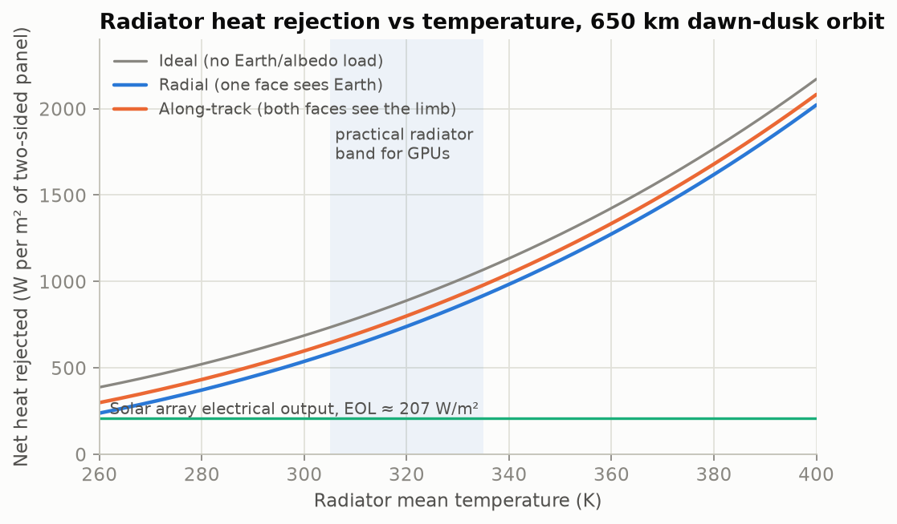
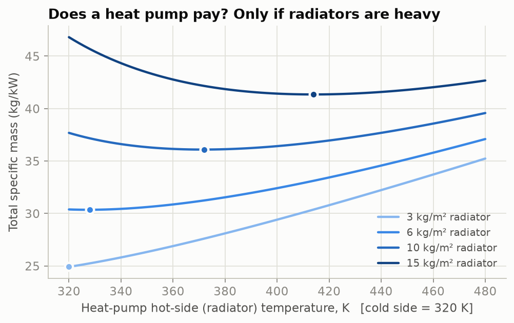

---

## 5. Mass budget

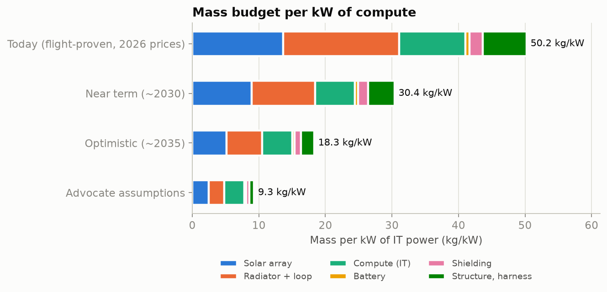

| kg per kW of IT | Today | Near term | Optimistic | Advocate |
|---|---|---|---|---|
| Solar array | 13.6 | 8.9 | 5.1 | 2.5 |
| Radiator + loop | 17.4 | 9.5 | 5.4 | 2.3 |
| Compute hardware | 10.0 | 6.0 | 4.5 | 3.0 |
| Battery (bus only) | 0.6 | 0.5 | 0.4 | 0.3 |
| Shielding | 2.0 | 1.5 | 1.0 | 0.5 |
| Structure & harness | 6.6 | 4.0 | 2.0 | 0.7 |
| **Total** | **50** | **30** | **18** | **9.3** |
| System W/kg | 20 | 33 | 55 | 108 |

Cross-checks:
- **arXiv 2604.27197** (an independent 2026 engineering study) gets **34–59 kg/kW** all-in, bracketing the today and near-term cases.
- **SpaceX's "100 GW from 1 Mt/yr"** implies ~10 kg/kW, the advocate case. AI1's "~70 kW per tonne" (~14 kg/kW) sits between optimistic and advocate.
- **Starcloud's 40 MW in one 100-t launch** implies 2.5 kg/kW, below even the mass of the GPUs, cold plates and power electronics alone (~3–6 kg/kW). Independent critics estimate ~22 launches for that 40 MW system, not one.
- Area is not the constraint people imagine. **1 GW needs ~6–7.5 km² of array plus radiator**, a few square kilometres of thin film. Building and stabilising such structures is the challenge, not finding room for them.

---

## 6. Radiation and computation errors

This is where the deepest open questions are, so it gets the most detail.

### 6.1 Dose

The environment in a 500–1000 km SSO has three components:
- **Trapped inner-belt protons**, met in the South Atlantic Anomaly. Hard to shield, and they rise steeply with altitude.
- **Outer-belt "horn" electrons** at high latitude. Easily shielded by a few mm of Al.
- **Galactic cosmic rays and solar-particle events**, reaching the spacecraft over the poles because the geomagnetic cutoff is low there. These matter for single-event effects rather than total dose.

I built a two-component phenomenological fit to published anchors, flagged as **±3×**, not a transport calculation:
- Google's ~150 rad(Si)/yr at 650 km behind ~10 mm Al (modelled);
- Shields-1 measured 75.6 rad/yr at 500 km;
- SPENVIS-type polar-LEO ~6 krad/yr behind 1 mm;
- ≤1.9 krad/yr at 800 km behind a few mm.

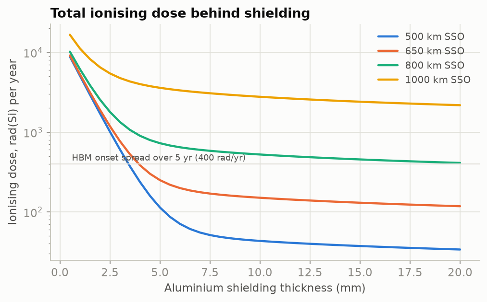

Key features:
- The **first ~5 mm of aluminium removes the electrons**. After that the dose plateaus because protons dominate. Going from 10 to 20 mm buys less than 2×, since a 100 MeV proton has a ~14 mm range in Al and makes secondaries.
- **Dose rises ~e-fold per ~120 km** above ~600 km. That is a hard altitude ceiling for COTS accelerators near ~700 km, even though higher orbits would mean fewer eclipses, less drag and less atomic oxygen.
- **10 mm of Al is 27 kg/m².** Wrapping densely packed compute in it costs ~1–2 kg/kW. That is affordable only because compute boards are compact. You cannot shield the arrays or the radiator.

### 6.2 What the dose does to an AI accelerator

The only public data on a modern datacenter accelerator is **Google's 67 MeV proton test of the Trillium TPU (v6e) with HBM**. All of these are per chip:
- **Silent data corruption (SDC)** in logic and SRAM: one per ~14–20 rad.
- **Uncorrectable HBM ECC error (UECC):** one per ~44 rad.
- **Functional interrupt (SEFI):** one per ~5 krad.
- **HBM total dose:** irregularities begin at ~2 krad; no hard failure up to 15 krad.

A cross-check from beam physics: a 67 MeV proton deposits ~8.5 MeV·cm²/g in silicon, so 1 rad ≈ 7×10⁶ p/cm². That makes $\sigma_\text{SDC}\approx 8\times10^{-9}$ cm² per chip and $\sigma_\text{SEFI}\approx 3\times10^{-11}$ cm², matching the published values.

Scaling the cross-sections by dose (valid when protons dominate, i.e. behind ≳5 mm):

| Orbit / shielding | Dose (rad/yr) | SDC per chip-yr | HBM UECC per chip-yr | SEFI per chip-yr | Years to HBM onset | Interrupt rate vs ground (UECC = crash / handled) |
|---|---|---|---|---|---|---|
| 500 km, 10 mm | 43 | 2.5 | 1.0 | 0.009 | 46 | ×7 / ×1.0 |
| **650 km, 10 mm** | **150** | **8.8** | **3.4** | **0.03** | **13** | **×21 / ×1.2** |
| 650 km, 3 mm | 770 | 45 | 18 | 0.15 | 2.6 | ×103 / ×1.9 |
| 800 km, 10 mm | 520 | 31 | 12 | 0.10 | 3.8 | ×70 / ×1.6 |
| 1000 km, 10 mm | 2,800 | 160 | 63 | 0.55 | 0.7 | ×370 / ×4.2 |

The ground reference is Meta's Llama-3 405B run: 419 unexpected interrupts in 54 days on 16,384 H100s, i.e. 0.17 interrupts per GPU-year (about one per 3 hours for the job).

**Consequences:**
- **Inference is fine.** ~9 silent errors per chip per year is roughly one corrupted answer per ~10⁷ inferences (Google's own estimate). Range checks, voting on critical outputs and periodic self-tests make this a non-issue for most commercial serving.
- **Large synchronous training is in trouble unless the software stack changes.** A 16,384-chip job at 650 km would see **an SDC every ~3.6 minutes and an HBM UECC every ~9 minutes**. With Young–Daly optimal checkpointing (30 s checkpoint, 5 min restart, calibrated to give ~90% goodput for the Llama-3 run):

| Interrupt rate vs ground | System MTBF | Optimal checkpoint interval | Goodput |
|---|---|---|---|
| ×1 (ground) | 3.1 h | 14 min | 0.90 |
| ×1.2 (UECC handled in place) | 2.6 h | 13 min | 0.89 |
| ×3 | 1.0 h | 8 min | 0.79 |
| ×10 | 0.31 h | 4 min | 0.50 |
| ×21 (each UECC crashes the job) | 0.15 h | 3 min | **0.10** |

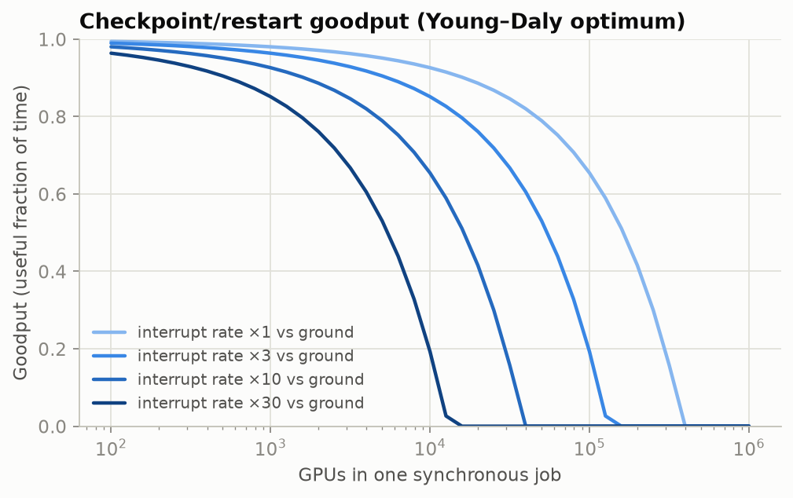

The engineering escape routes are real but unproven at scale:
- **Treat HBM UECCs as recoverable:** poison the data, recompute the micro-batch, skip the step.
- **Algorithm-based fault tolerance** (checksummed matrix multiplies) to catch SDCs cheaply.
- **Asynchronous, low-communication training** (DiLoCo family), so that one chip's fault does not stall 16,000 others.

None of these is how frontier training is run today.

**What is not known yet:**
- No heavy-ion single-event-latchup data exist for any datacenter GPU or TPU. A latchup on a high-current rail could be destructive.
- No flight error statistics have been published (Starcloud-1 published none; Suncatcher's prototype only just launched).
- Rad-tolerant-by-design accelerators would change this table. Possible approaches: hardened HBM base die, ECC on register files, lockstep cores.

### 6.3 Hard failures without repair

Mean surviving capacity when failures are never replaced:

| Annual failure rate | 3 yr | 5 yr | 7 yr |
|---|---|---|---|
| 2% | 0.97 | 0.95 | 0.93 |
| 5% | 0.93 | 0.88 | 0.84 |
| 10% | 0.86 | 0.78 | 0.71 |
| 20% | 0.73 | 0.60 | 0.51 |

What the failure rate is likely to be:
- Llama-3's GPU+HBM interrupt rate annualises to ~9%/yr, an upper bound for permanent failures (many were fixed by reseating or resetting).
- NCSA measured 99.3% node availability on H100 systems.
- HPE's Spaceborne Computer-1 lost 9 of 20 SSDs and 1 of 4 power supplies in ~20 months on the ISS.
- Starlink, the best fleet data point, runs ≤1–3% satellite failure.

I use 3%/yr on the ground, multiplied by 1–2× in orbit. Spares can be flown instead, but they cost exactly the IT dollars they protect.

---

## 7. Materials, debris and environmental lifetime

- **Atomic oxygen.** At 650 km, atomic oxygen flux is ~20–50× lower than at the ISS. Even in full ram, Kapton erodes ~1.5 µm/yr (yield 3×10⁻²⁴ cm³/atom), and in this orbit the arrays are nearly edge-on to the flow. Not limiting. It is the reason not to go below ~550 km.
- **Radiator coatings.**
  - Z-93/AZ-93 white paint gained only Δα ≈ 0.01 in 5.8 years on LDEF.
  - Silver-Teflon on Hubble gained Δα ≈ 0.06–0.08 in 8 years, with cracking.
  - The model already uses an end-of-life $\alpha = 0.20$. Contamination from outgassing is the bigger practical risk.
- **Solar cells.** Silicon loses ~2.5%/yr and III-V ~1–1.5%/yr (on-orbit measurement: GaAs subcell −4.1%/yr, Si subcell −2.5%/yr, PRX Energy 2026). Over 5 years that costs ~12% of array power, which is designed in.
- **Thermal cycling.** Only during the ~87-day eclipse season: ~1,300 shallow cycles per year if compute throttles. Benign compared with many terrestrial GPU power cycles. Not limiting.
- **Micrometeoroids and debris (MMOD).** This is the under-discussed environmental risk at scale.
  - Debris density peaks at 700–900 km, from the Fengyun-1C and Iridium–Kosmos fragments.
  - Using order-of-magnitude ORDEM-class fluxes (≥1 cm: 10⁻⁵–10⁻⁴ m⁻²yr⁻¹, unverified), **1 GW (~7 km²) takes ~70–700 centimetre-class hits per year**. Millimetre-class hits number in the thousands.
  - Thin arrays degrade gracefully. **Pumped radiator loops do not**: one puncture vents the coolant. That pushes designs toward segmented loops or individual heat pipes, which are heavier.
  - Each hit also makes new debris.
  - Starlink already performed ~355,000 avoidance manoeuvres between June 2025 and May 2026. A rigid km-scale structure cannot dodge, and a 100–200 m formation must manoeuvre as a unit.
- **Re-entry.** With a ~5-year life, 1 GW in orbit means **~4,000–6,000 t/yr of hardware re-entering**. 100 GW would mean ~400,000–600,000 t/yr, more than 10× the natural meteoroid influx (~15,000–40,000 t/yr; approximate). And this material is aluminium-rich. Alumina from satellite demise is an open stratospheric-ozone research question. This externality, not cost, may be the binding constraint at the 100 GW scale.

---

## 8. Communications

| Need | Requirement | Available | Verdict |
|---|---|---|---|
| Text inference to users | ~4–6 B/token × ~5k tok/s/GPU → **~0.1 Gbps per MW**; ×10 margin for prompts and context → ~1.3 Gbps/MW | Starlink V3: ~1 Tbps down, 1.2 Tbps RF backhaul per sat (spec); optical downlink records 200 Gbps (TBIRD 2023), 120 Gbps (China 2026) | **Easy.** 1 GW of text inference ≈ 0.1–1.3 Tbps |
| Latency | LEO 2–4 ms physical, ~25 ms through Starlink | Fine for chat and agents | **Fine** |
| Model upload, checkpoints | 1–16 TB per model | One TBIRD-class pass moves 4.8 TB | **Fine** (hours) |
| Training: tensor/expert parallel (scale-up) | NVLink 5: 14.4 Tbps per GPU; ~1 Pbps per NVL72 rack | Nothing in free space comes close | **Must stay inside one spacecraft** |
| Training: data-parallel all-reduce | 1T params, bf16, 10 s step → ~3.2 Tbps per cut | Long-range ISLs 0.1–0.4 Tbps; Suncatcher target ~10 Tbps per link at <1 km (1.6 Tbps bench) | **Needs km-scale formations, or low-communication training (DiLoCo-type, 100–500× less traffic)** |

The physics of the optical link explains Google's 100–200 m formation.
- A 10 cm aperture at 1.55 µm diverges at ~15 µrad, and its near field extends ~6.5 km.
- Inside ~1 km essentially all transmitted power is caught (computed captured fraction = 1.0). At 100 km it is 2.6×10⁻³; at 5,000 km it is 10⁻⁶.
- Commercial dense-wavelength-multiplexed (DWDM) receivers need hundreds of µW. That is ~100× more than long-haul inter-satellite receivers and ~100× above the photon-counting floor (≈1.3 µW per Tbps at 10 photons/bit).
- So terabit links force satellites to fly almost touching. That trades a communications problem for a formation-flying and collision problem.

Ground links are weather-limited for optical (~10 stations needed for 99.9% availability in Europe) and spectrum-limited for RF (~1 Tbps per satellite even for Starlink V3). Neither matters for inference. Both rule out splitting a synchronous training job between orbit and the ground.

---

## 9. Economics

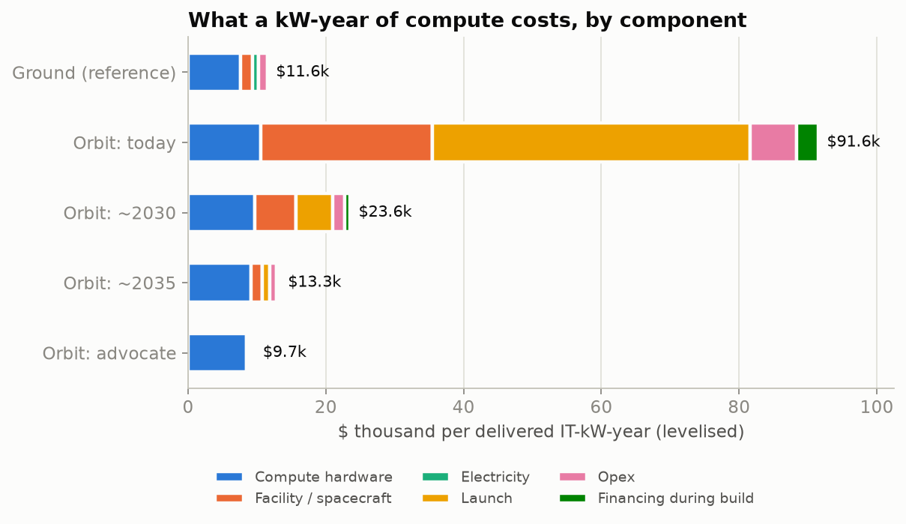

### 9.1 The structural argument

On the ground, levelised cost per delivered IT-kW-year is **$11.6k**:

| Component | Cost | Share |
|---|---|---|
| Compute hardware | $7.6k | 66% |
| Facility | $1.8k | 15% |
| Electricity | $0.84k | 7% |
| Opex | $1.4k | 12% |

At ~1.8 kW all-in per Blackwell GPU, this is **$2.37 per GPU-hour**, matching SemiAnalysis's independent 2026 figure to the cent.

Moving to orbit can remove electricity, the building and most of the opex. It leaves the chips untouched, and then:
- makes chips **slightly dearer** (qualification and screening, 5–15%);
- makes them **less productive** (4% eclipse throttling, 5–14% capacity lost to unrepaired failures);
- forces **the entire "facility" to be thrown away every ~5 years** with the chips, instead of lasting 15+.

With *free* launch and a *free* satellite bus, the space/ground ratio is still **1.02 (today), 0.94 (near term), 0.88 (optimistic), 0.80 (advocate)**. **That is the ceiling: orbit can never be more than ~20–25% cheaper while the chips cost what they cost.**

### 9.2 Full results

| | Today | Near term | Optimistic | Advocate |
|---|---|---|---|---|
| Space $/IT-kW-yr | $91.6k | $23.6k | $13.3k | $9.7k |
| Ground $/IT-kW-yr | $11.6k | $11.6k | $11.6k | $11.6k |
| **Ratio** | **7.9** | **2.0** | **1.15** | **0.84** |
| $/GPU-hour, space vs ground | $18.8 vs $2.37 | $4.84 vs $2.37 | $2.73 vs $2.37 | $1.98 vs $2.37 |
| "Power + cooling + housing" per IT-kWh, space vs ground | $9.24 vs $0.45 | $1.58 vs $0.45 | $0.48 vs $0.45 | $0.13 vs $0.45 |
| Break-even launch price (all else fixed) | none | none | none | $720/kg |
| Ground electricity price needed for parity | $7.7/kWh | $1.22/kWh | $0.24/kWh | <0 (orbit wins outright) |

Cross-checks:
- **SemiAnalysis** (June 2026) has space at $8.64 vs $2.37 per GPU-hour, 3.6×, sitting between our today and near-term cases. They project parity in the late 2030s, consistent with our optimistic case.
- **McCalip's calculator** (excluding GPUs) has $31–51/W orbital vs ~$15/W terrestrial for 5 years. Our near-term non-IT capex is ~$38/W.

### 9.3 Break-even maps

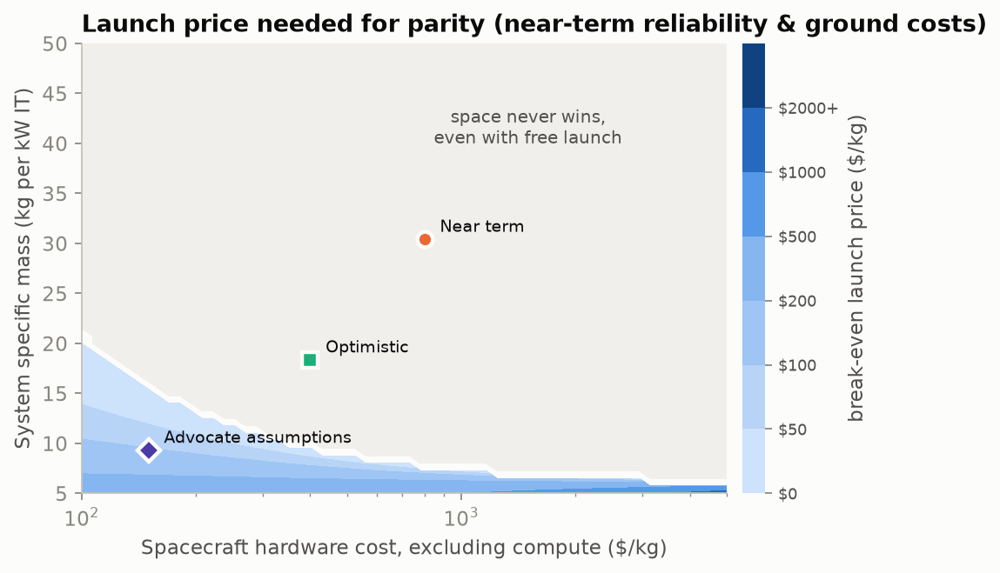

At near-term reliability and ground costs, parity *at any launch price* requires **specific mass below ~20 kg/kW with spacecraft hardware below ~$150/kg**, or below ~10 kg/kW at ~$700–1,000/kg.
- Starlink V2-mini-class hardware costs ~$1,000/kg, and V3 is estimated at ~$650/kg.
- So parity needs satellites built **~3–5× cheaper per kg than Starlink**, at **~2–3× better specific power than any flown design**, launched at **≤ $200/kg**. All three at once.

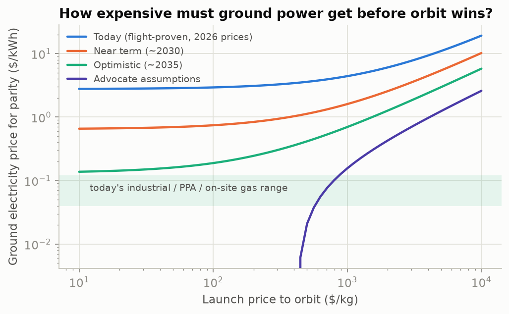

**The "moving threshold".** Your terrestrial-demand model can plug into this second chart. It gives the all-in ground electricity price at which orbit breaks even, as a function of launch price.
- At $200/kg launch the near-term design breaks even only if ground power exceeds **~$0.84/kWh**; the optimistic design at **~$0.24/kWh**.
- Grid scarcity can push *grid* prices up. But behind-the-meter gas turbines and solar-plus-storage cap the practical ground price at roughly $0.08–0.15/kWh. That is my rough estimate: a 2026 solar-plus-storage PPA is ~$0.082/kWh, and gas PPAs ~$0.116/kWh.
- So power scarcity alone does not rescue orbit unless *all* ground options are blocked: permitting, turbines, transformers.
- The honest form of the scarcity argument is about **time-to-power**, not price. An idle $30k/kW chip waiting a year for power costs ~$7.6k/kW in capital charge. That is equivalent to ~$0.87/kWh, comparable to the near-term break-even. Orbit only wins this race if satellites and launches can be produced faster than ground power can be built. At 100–500 launches per GW, that is not obvious.

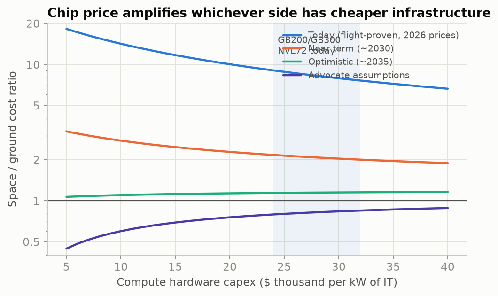

**Chip price is a lever on the whole comparison.** As compute hardware gets cheaper per watt, the space/ground ratio tends toward the ratio of *infrastructure* costs: "power + cooling + housing" per kWh, $1.58 vs $0.45 near term and $0.13 vs $0.45 advocate.
- If accelerators fall to ~$10k/kW (custom ASICs, a vertically integrated buyer), the near-term ratio *worsens* from 2.0 to 2.8.
- The optimistic case is roughly flat (1.15 → 1.10).
- The advocate case *improves* from 0.84 to 0.60.
- So the advocates' story is internally consistent: *if* space infrastructure gets far cheaper than ground infrastructure *and* chips get cheap, orbit could win by more than the ~20% ceiling above. Both conditions must hold. With today's ~$30k/kW chips, the ceiling stands.

### 9.4 Uncertainty

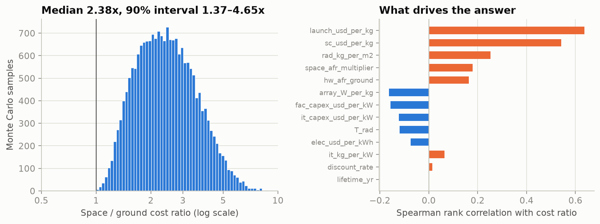

A Monte Carlo over a generous 2030s envelope varies 13 inputs independently:

| Input | Range |
|---|---|
| Launch | $100–3,000/kg (log-uniform) |
| Spacecraft hardware | $300–3,000/kg (log-uniform) |
| Array specific power | 100–400 W/kg |
| Radiator areal mass | 3–12 kg/m² |
| Radiator temperature | 305–345 K |
| IT hardware mass | 3–10 kg/kW |
| IT capex | $20–40k/kW |
| Facility capex | $10–25k/kW |
| Electricity | $0.05–0.15/kWh |
| Ground hard-failure rate | 2–6%/yr |
| Space failure multiplier | 1–3× |
| Discount rate | 6–12% |
| Life | 4–7 yr |

Results:
- **Ratio:** median **2.38×**, 50% interval 1.8–3.2×, 90% interval **1.37–4.65×**.
- **P(space cheaper) < 0.1%**, even restricted to launch < $150/kg. The envelope does not reach the advocate corner: specific power > 400 W/kg and hardware < $300/kg at once.
- **What drives the ratio** (Spearman rank correlation, ρ): launch price (+0.64) and spacecraft hardware cost (+0.54) dominate, then radiator areal mass (+0.25) and the failure-rate multipliers. Electricity price barely matters (ρ = −0.07), which restates the structural argument.

---

## 10. Scale and logistics

| | 1 GW in orbit | Launches (100 t) | Array + radiator area | Re-entry at 5-yr life |
|---|---|---|---|---|
| Today design | 50,000 t | ~500 | 7.5 km² | 10,000 t/yr |
| Near term | 30,000 t | ~300 | 7.3 km² | 6,100 t/yr |
| Optimistic | 18,000 t | ~180 | 6.8 km² | 3,700 t/yr |
| Advocate | 9,300 t | ~93 | 6.0 km² | 1,900 t/yr |

- **SpaceX's "100 GW per year"** at advocate mass is ~930,000 t/yr, ~9,300 Starship flights per year (25 a day). At near-term mass it is ~30,000 flights per year.
- **Today's mass to orbit**, all rockets, is of order a few thousand tonnes per year (approximate).
- So even 1 GW per year means ~100–300 dedicated heavy launches a year, comparable to the *entire* current world launch rate. 100 GW/yr is two orders of magnitude beyond anything that exists.

---

## 11. Where the genuine open possibilities are

These are the levers that could move the conclusion, roughly in order of leverage.

1. **Spacecraft cost per kg (ρ = +0.54).** The question is whether power and thermal hardware can be "automotive-ised" to ~$100–300/kg, 3–10× below Starlink. Thin-film or perovskite arrays (bare-cell >2,000 W/kg; array-level unproven) and printed or roll-to-roll radiators are the candidates. This is a manufacturing question, not physics.
2. **Launch price (ρ = +0.64).** Starship flying fully reusable at high cadence. Below ~$100/kg, launch stops mattering and lever 1 dominates.
3. **Hot chips.** Raising the allowed radiator temperature from 320 to 360 K cuts radiator area ~40% (q from 740 to ~1,250 W/m²). An accelerator and HBM qualified for ~120 °C junctions would be worth more to an orbital design than any radiator material.
4. **Rad-tolerant accelerators and fault-tolerant training.** Recoverable UECCs, ABFT and asynchronous training would move training goodput from ~0.1 to ~0.9 at 650 km. This is the gating item for "training in space". Inference already works.
5. **Longer economic life.** If chips stay economically useful 7–10 years (slowing hardware improvement, or inference on old silicon), the satellite amortises over longer. But the no-repair attrition then bites harder. In the Monte Carlo, lifetime is a wash (ρ ≈ 0).
6. **Niche markets where orbit wins regardless of cost per FLOP:**
   - processing data that is already in orbit (Earth-observation imagery is TB/day per satellite, and downlink is the bottleneck);
   - space situational awareness and defence edge;
   - jurisdiction or sovereignty arbitrage;
   - very-low-latency relay.
   These are 10–100 MW markets, not 100 GW.
7. **Externalities.** Launch emissions (ESA ASCEND: CO₂ benefit only with ~10× cleaner launchers), re-entry alumina, debris. These are unpriced today and could become binding before economics does.

---

## 12. Verdict

| Question | Answer |
|---|---|
| Power balance | **Feasible and favourable.** ~6× more energy per m² than ground; 96% sunlit at 650 km SSO; but only economical with cheap silicon arrays. |
| Cooling | **Feasible.** Radiator ≈ 28% of array area at ~320 K; ~740 W/m². Mass (6–15 kg/m² with loops) is the real cost. Public claims of 838–1,400 W/m² are ideal-body or hot-chip numbers. |
| Communications | **Fine for inference** (~1 Gbps/MW). **Training must fit inside a satellite or a sub-km formation**, or use low-communication algorithms. |
| Computation errors | **Fine for inference; a serious unsolved problem for large synchronous training** (SDC every ~4 min, UECC every ~9 min on 16k chips at 650 km). Altitude effectively capped at ~700 km for COTS HBM. |
| Materials / lifetime | **Not limiting over 5 yr** at 600–700 km, except MMOD on pumped radiator loops. Debris, re-entry and collision-avoidance externalities grow with scale. |
| Scale | 1 GW ≈ 10k–50k t and ~100–500 heavy launches, refreshed every ~5 yr. |
| Profitability | **No** at today's or ~2030 costs (2–8× more expensive). **Marginal** (±15%) in a ~2035 world with $200/kg launch and $400/kg hardware. **At best ~15–25% cheaper** under the most aggressive assumptions with today's chip prices, because chips are ~2/3 of the cost and orbit cannot touch them. That rises to ~40% only if chips *also* become ~3× cheaper per watt. |

**What would change my mind** (signposts to watch):
1. A ≥100 kW compute satellite operating ≥1 year with published error, thermal and failure statistics.
2. Starship commercial prices below $300/kg.
3. A satellite power-and-thermal system sold below ~$300/kg at >60 W/kg system level.
4. Heavy-ion latchup data and in-orbit SDC rates for a datacenter accelerator.
5. A frontier-scale training run done with asynchronous, fault-tolerant methods.

---

## 13. Sources

Many figures were gathered via search snippets because primary PDFs were not reachable from this environment. Items marked † should be verified against the primary source before formal citation.

**Industry and claims**
- Starcloud whitepaper summary and critique: blocksandfiles.com/architecture/2025/10/23/starcloud-pitches-orbital-datacenters-as-cheaper-cooler-and-cleaner/1597295 ; angadh.com/space-data-centers-1 †
- Starcloud-1: geekwire.com/2025/starcloud-power-training-ai-space/ ; cnbc.com/2025/12/10/nvidia-backed-starcloud-trains-first-ai-model-in-space-orbital-data-centers.html
- Starcloud-3 / $500/kg: npr.org/2026/04/03/nx-s1-5718416/ai-data-centers-in-space-spacex-elon-musk †
- Google Suncatcher: arXiv:2511.19468 ; research.google/blog/exploring-a-space-based-scalable-ai-infrastructure-system-design/ ; prototype launch: cnbc.com/2026/10/01/spacex-to-launch-google-ai-chips-to-orbit-with-planet-labs-satellites.html
- SpaceX FCC filing: datacenterdynamics.com/en/news/spacex-files-for-million-satellite-orbital-ai-data-center-megaconstellation ; AI1: datacenterdynamics.com/en/news/spacex-details-ai1-satellite-data-center-claims-150kw-peak-compute/ † ; S-1 risk factor: thenextweb.com/news/spacex-orbital-data-centres-ipo-risk-disclosure †
- Starship Flight 14: space.com/space-exploration/launches-spacecraft/spacex-starship-megarocket-flight-14-orbital-launch-success
- SemiAnalysis: newsletter.semianalysis.com/p/to-boldly-go-the-case-for-space-datacenters † ; McCalip: andrewmccalip.com/space-datacenters † ; IEEE Spectrum: spectrum.ieee.org/orbital-data-centers ; Gartner: theregister.com/2026/02/25/gartner_orbiting_datacenter_peak_insanity
- arXiv:2604.27197, "Orbital Data Centers: Spacecraft Constraints and Economic Viability" (2026) †
- ESA ASCEND: cordis.europa.eu/project/id/101082517
- Epoch AI cost breakdown: epoch.ai/data-insights/ai-datacenter-cost-breakdown

**Hardware and costs**
- Redwire ROSA / DART: redwirespace.com ; ISS radiators: news.lockheedmartin.com/2000-11-28-... †
- Space cell costs: spw.aerospace.org/files/2024/07/5_EG1_P.-Jahelka_Presentation.pdf † ; newswise.com (Surrey silicon study) †
- GB200 NVL72 cost: wing.vc/content/how-much-does-an-nvidia-nvl72-cost † ; facility capex: datacentres.com/news/data-centre-construction-costs-11m-per-mw † ; EIA STEO electricity ; LevelTen PPA index via pv-magazine-usa.com
- Meta Llama-3 failures: arXiv:2407.21783 ; datacenterdynamics.com/en/news/meta-report-details-hundreds-of-gpu-and-hbm3-related-interruptions-to-llama-3-training-run

**Radiation and environment**
- Shields-1 dosimetry: ntrs.nasa.gov/api/citations/20220013680 ; NASA LLIS 824 ; Jetson radiation: escies.org (webDocumentFile id 70931) † ; 16 nm SEU: osti.gov/servlets/purl/1640003
- HPE Spaceborne Computer: issnationallab.org/iss360/supercomputing-in-space-hpes-spaceborne-computer-returns/
- Atomic-oxygen erosion yields: ntrs.nasa.gov/api/citations/20070002707 ; Hubble Ag-FEP: ntrs.nasa.gov/api/citations/19990024887 ; ORDEM 3.1: ntrs.nasa.gov/api/citations/20220002309
- Thermospheric density: Vallado, *Fundamentals of Astrodynamics and Applications* (exponential model, CIRA-72)

**Communications**
- TBIRD 200 Gbps: nasa.gov (Ames) ; AIRCAS 120 Gbps: english.aircas.ac.cn (Jan 2026) † ; Starlink laser capacity: advanced-television.com/2024/02/02/spacex-reveals-starlink-laser-capacity/
- DiLoCo: arXiv:2311.08105 ; Streaming DiLoCo: arXiv:2501.18512 ; INTELLECT-1: arXiv:2412.01152
- Optical ground-station diversity: doi:10.1364/JOCN.7.001148

---

## Appendix: running and modifying the model

```bash
pip install numpy scipy matplotlib
python3 space_dc_model.py        # ~5 s; prints all tables, writes figures/ and results.json
```

- Every input lives in the `Design`, `Econ` and `Reliability` dataclasses, with provenance comments. `scenarios()` defines the four cases. `MC_RANGES` defines the Monte Carlo envelope.
- To couple to a terrestrial demand model, get the orbit context with `default_context()`, pass a future ground electricity price (and facility capex) into `Econ` and call `evaluate()`. `breakeven_ground_power_price()` returns the threshold directly. See the README for an example.
- **Known simplifications:**
  - The dose model is a fit, not a transport calculation.
  - MMOD and AO numbers are order-of-magnitude.
  - The radiator is treated as isothermal at its mean temperature, with a fin-efficiency factor.
  - No orbital-assembly costs.
  - Insurance and spectrum are lumped into opex.
  - Chip prices are taken as identical in both places, apart from the space premium.
